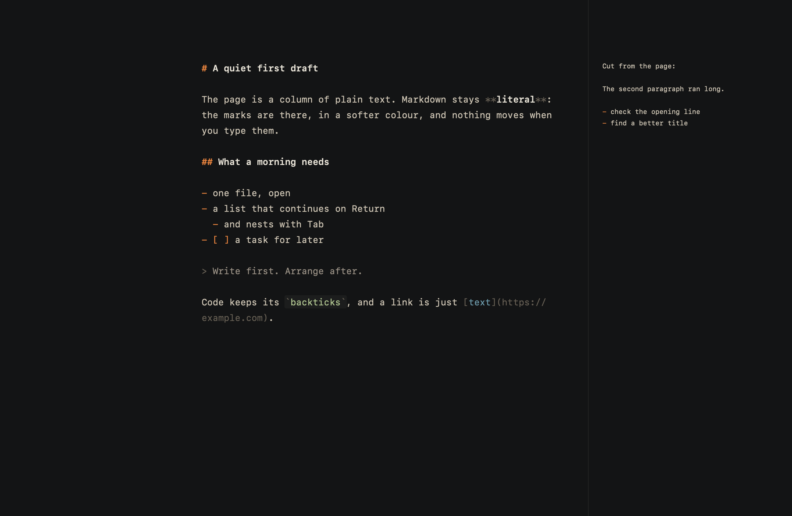

# Flowriter

A quiet, native macOS writing app for Markdown, in the spirit of a terminal or a code
editor. One note per window, a centred column of plain text, and a notes drawer beside it.

Flowriter is Swift and AppKit. It works offline: no account, no AI, and no network calls
except Check for Updates, which runs only when you choose it.

<picture>
  <source media="(prefers-color-scheme: light)" srcset="docs/media/flowriter-light.png">
  
</picture>

## Features

- **Literal Markdown.** Markdown shows as colour and weight on the text you typed. Every line
  has the same height and every style has the same character width, so typing a heading, a
  list marker or a code fence never moves the text around it.
- **Lists.** Return continues a list, Return on an empty item leaves it, Tab and Shift-Tab
  nest, Backspace after a marker removes the marker.
- **Notes drawer.** A drawer beside the page, with a drag edge to set its width. Use it for
  cut text and side thoughts: Move Selection to Notes sends the selected text there. The
  notes are a plain file next to the document, `.<name>.notes.md`.
- **New notes.** Command-N opens a note with no file. Its name comes from its first line
  ("# Happy days" is `happy-days`) and shows in the top bar. A click on the name saves it:
  the sheet offers that name and the default location, so Return is enough. The sheet adds
  `.md` to the name. Its pop-up picks another saved location (File > Locations) or any
  folder. A click on a saved note's name renames or moves it.
- **Drafts.** Unsaved notes are kept as drafts while you type. Closing one opens the same
  sheet, with Save, Delete and Cancel. Quitting never asks: at the next launch the unsaved
  notes and the open files come back.
- **Focus Mode** keeps the caret line on the vertical centre of the window.
- **Files.** A note saves in place soon after typing stops. A change another program makes to
  the file is loaded when there are no edits here, and is never overwritten when there are.
- **Print** (Command-P). The text prints as you typed it, in black. The print panel's
  Flowriter section picks the font and its size, and can start a new page at each `---` rule
  (the rule itself is not printed; front matter and code blocks never break). The choices are
  kept for the next print.
- **Light and dark.** The colours follow the system appearance, or stay light or dark.
- **Settings** (Command-Comma). One window for the appearance, the text sizes, Focus Mode and
  the folders new notes go to.
- **Updates.** Flowriter > Check for Updates reads the latest GitHub release and shows what
  is new. Install and Relaunch downloads it, checks that it is the same app, the version the
  release names and intact (its code signature), quits the normal way (unsaved notes are kept
  as drafts) and opens the new version. It never checks on its own.

Undo, input methods, spell check and find are the system's.

## Keys

| Key | What |
|---|---|
| Command-Comma | Settings |
| Command-N | New note |
| Command-S | Save: name the note and pick its folder |
| Command-P, Shift-Command-P | Print, page setup |
| Option-O | Show or hide the notes drawer |
| Shift-Option-O | Switch between the page and the notes |
| Shift-Command-M | Move the selection to the notes |
| Control-Command-Up, Control-Command-Down | Move the line (or the selected lines) up or down |
| Shift-Command-F | Focus Mode |
| Command-B, Command-I | Bold, italic: wrap the selection in the Markdown marks |
| Command-Plus, Command-Minus, Command-0 | Bigger text, smaller text, actual size |
| Option-Command-Plus, Option-Command-Minus | Bigger or smaller notes text |
| Command-F, Option-Command-F | Find, find and replace |

## Build

Requires macOS 14+ and Swift 6 (Xcode 16 or a matching toolchain).

```sh
swift run Flowriter [file.md]        # run it (unbundled)
scripts/bundle.sh                    # release build -> build/Flowriter.app
INSTALL=1 scripts/bundle.sh          # ...and install it as /Applications/Flowriter.app
scripts/install.sh                   # install build/Flowriter.app (SRC= for another build)
```

`scripts/install.sh` asks a running copy to quit the normal way, so unsaved notes come back,
and opens it again afterwards. `scripts/release.sh` installs every release it publishes.

Set `THROTTLE` to a wrapper command (for example `nice -n 10`) to lower the build's
priority. The app is ad-hoc signed unless `DEVELOPER_ID` is set (`scripts/sign.sh`). The
bundle id is `app.flowriter.Flowriter`; set `BUNDLE_ID` to build under another one.

A running app updates itself from Flowriter > Check for Updates. From a script,
`Flowriter.app/Contents/MacOS/Flowriter --update-now` does the same without asking.

## Layout

| Path | What |
|---|---|
| `Sources/FlowriterKit` | The app: Markdown styling, list editing rules, the text view, the document, the window with its notes drawer, drafts and locations. |
| `Sources/Flowriter` | The executable: starts the app, and renders one picture with `--snapshot`. `--offscreen` runs the app with its windows off every screen; `--update-now` installs a newer release at launch. |
| `Sources/FlowriterDrive` | A driver that runs the real app off screen from a script of key and mouse steps. |
| `Tests/FlowriterKitTests` | Unit tests (XCTest). |
| `Tests/FlowriterDrive` | The scripted sessions for the driver. |
| `docs/media` | The README pictures and the sample note they come from. |

## Testing

```sh
scripts/check.sh      # build + unit tests, last line CHECK PASS or CHECK FAIL
scripts/drive.sh      # a scripted writing session, off screen -> build/drive/*.png
```

Run `scripts/check.sh` before a push. `git config core.hooksPath .githooks` makes git run it
before every push. CI runs the same script. The tests need no network and no files outside
the repo.

`scripts/drive.sh` runs the real app with its window parked off every screen and never
activates it, so it is safe on a desktop in use. It sends the key and mouse steps of
`Tests/FlowriterDrive/session.txt`, checks the text after them, and saves a picture of the
window at each `shot` step. A run fails when one of its windows touches a real screen.

## License and credits

Flowriter is free software, licensed under the **GNU General Public License v3.0 or later**
(GPL-3.0-or-later). See [LICENSE](LICENSE).

Versions up to 0.1.12 were a fork of [Flo State](https://github.com/Altimor/flo-state) by
Altimor, itself a derivative of
[writer-computer](https://github.com/joelbqz/writer-computer) by Joel
([@joelbqz](https://github.com/joelbqz)) and contributors, both GPL-3.0. The current app is
a separate codebase and contains no code from either project. It bundles no third-party code.

The text face is [Paper Mono](https://github.com/paper-design/paper-mono) by Paper, under the
SIL Open Font License 1.1. The font files and their license are in `Resources/Fonts`.
